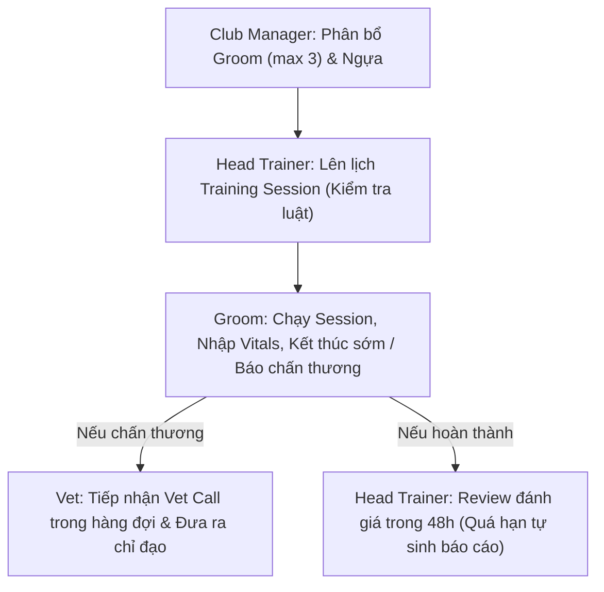

# TRACEN RACING CLUB - MANUAL WEB TESTING GUIDE
## Comprehensive Business Flow Verification (Training, Scoping, Vet Calls & Notifications)

Tài liệu này cung cấp kịch bản kiểm thử từng bước (Step-by-step Test Scenarios) trên giao diện Web dành cho tất cả các nghiệp vụ quản lý huấn luyện vừa được cập nhật và hoàn thiện.

---

## 1. THÔNG TIN TÀI KHOẢN KIỂM THỬ (DEMO ACCOUNTS)

> **Mật khẩu chung cho tất cả các tài khoản demo:** `123456`

| Role | Username | Full Name | Ghi chú & Trách nhiệm kiểm thử |
| :--- | :--- | :--- | :--- |
| **CLUB_MANAGER** | `hoa.tm` | Trần Minh Hòa | Quản lý clb, phân quyền Groom cho Trainer, phân ngựa & đặt hạn mức |
| **HEAD_TRAINER** | `thang.nd` | Nguyễn Đức Thắng | HLV trưởng 1: quản lý ngựa được giao, lên lịch tập, review session |
| **HEAD_TRAINER** | `lam.tb` | Trần Bảo Lâm | HLV trưởng 2: dùng để test tính cô lập (chỉ thấy ngựa của mình) |
| **GROOM** | `binh.lv` | Lê Văn Bình | Groom trực tiếp thực hiện buổi tập, nhập vitals, kết thúc sớm/gọi vet |
| **GROOM** | `nam.tq` | Trương Quang Nam | Groom 2: kiểm thử phân bổ và giới hạn 3 groom / trainer |
| **GROOM** | `hieu.lm` | Lê Minh Hiếu | Groom 3: kiểm thử phân bổ và giới hạn 3 groom / trainer |
| **GROOM** | `phuc.nd` | Nguyễn Đình Phúc | Groom 4: kiểm thử phân công huấn luyện & nhận giáo án |
| **GROOM** | `dat.pt` | Phan Tiến Đạt | Groom 5: kiểm thử nhận tối đa 2 training plans |
| **GROOM** | `long.vh` | Vũ Hoàng Long | Groom 6: kiểm thử chăm sóc và buổi tập |
| **GROOM** | `hung.tv` | Trần Văn Hùng | Groom 7: kiểm thử chặn chuyển trainer khi có plan active |
| **GROOM** | `tri.nm` | Ngô Minh Trí | Groom 8: kiểm thử thực hiện buổi tập và nhập vitals |
| **GROOM** | `khoa.da` | Đặng Anh Khoa | Groom 9: kiểm thử phân bổ huấn luyện viên |
| **GROOM** | `thanh.bm` | Bùi Minh Thành | Groom 10: kiểm thử phân bổ huấn luyện viên |
| **VETERINARIAN** | `ha.pt` | Phạm Thu Hà | Bác sĩ thú y: nhận và xử lý Vet Calls từ Groom/Trainer |
| **HORSE_OWNER** | `anh.dq` | Đặng Quốc Anh | Chủ ngựa: nhận thông báo phân trainer, xem kết quả session |

---

## 2. CÁC KỊCH BẢN KIỂM THỬ CHI TIẾT

---

### KỊCH BẢN 1: Club Manager phân bổ Groom cho Head Trainer (Tối đa 3 Groom)
* **Tài khoản test:** `hoa.tm` (Club Manager), `thang.nd` (Head Trainer), `binh.lv` (Groom)
* **Màn hình kiểm tra:** `/manager/staff` và chuông thông báo (Notification Bell)

#### Các bước thực hiện:
1. Đăng nhập tài khoản `hoa.tm`.
2. Điều hướng vào menu **Staff Management** (`/manager/staff`).
3. Tại danh sách nhân viên, tìm đến các nhân sự có Role là **Groom** (ví dụ: `Lê Văn Bình`, `Trương Quang Nam`, `Lê Minh Hiếu`).
4. Tại cột **Supervisor / Head Trainer**, nhấn chọn phân Head Trainer phụ trách là `Nguyễn Đức Thắng`.
5. Thử phân tiếp groom thứ 2, thứ 3 cho `Nguyễn Đức Thắng` -> Hệ thống lưu thành công.
6. Thử phân thêm groom thứ 4 cho `Nguyễn Đức Thắng` -> Kiểm tra thông báo chặn.
7. Đăng nhập tài khoản Groom (`binh.lv`) và Head Trainer (`thang.nd`) để kiểm tra chuông thông báo.

#### Kết quả mong muốn:
* Club Manager phân được tối đa **3 Groom** cho 1 Head Trainer.
* Khi phân Groom thứ 4 cho cùng 1 Head Trainer, hệ thống hiển thị thông báo lỗi: *"Head Trainer already manages the maximum limit of 3 grooms"*.
* Cả **Groom** và **Head Trainer** đều nhận được thông báo chuông tức thì:
  * Groom nhận: *"You have been assigned to Head Trainer Nguyễn Đức Thắng"*.
  * Trainer nhận: *"Groom Lê Văn Bình has been assigned to your supervision"*.

#### Lỗi có thể xảy ra & Cách nhận biết:
* *Lỗi:* Danh sách dropdown Head Trainer không hiển thị hoặc không lưu được.
* *Nhận biết:* Báo lỗi mạng đỏ hoặc dropdown bị disable.

---

### KỊCH BẢN 2: Club Manager phân bổ ngựa & Hạn mức cho Head Trainer
* **Tài khoản test:** `hoa.tm` (Club Manager), `thang.nd` (Head Trainer), `anh.dq` (Horse Owner)
* **Màn hình kiểm tra:** `/manager/horses` -> Bấm vào chi tiết 1 ngựa (`/manager/horses/{id}`)

#### Các bước thực hiện:
1. Đăng nhập tài khoản `hoa.tm`.
2. Vào trang **Horses** (`/manager/horses`), chọn một ngựa thuộc clb (ví dụ: `Symboli Rudolf`).
3. Mở tab **Identity & Allocation** hoặc nút **Edit Identity & Trainer**.
4. Tại mục **Assigned Head Trainer**, chọn `Nguyễn Đức Thắng`.
5. Bấm **Save Changes**.
6. Đăng nhập tài khoản Head Trainer `thang.nd` và Horse Owner `anh.dq` kiểm tra chuông thông báo.

#### Kết quả mong muốn:
* Ngựa được lưu người quản lý là `Nguyễn Đức Thắng`.
* Trainer `thang.nd` nhận thông báo: *"The club manager assigned Symboli Rudolf (TM-0481) to your training management"*.
* Chủ ngựa `anh.dq` nhận thông báo: *"Your horse Symboli Rudolf (TM-0481) is now managed by Head Trainer Nguyễn Đức Thắng"*.
* Nếu Head Trainer đã đạt hạn mức tối đa số ngựa được giao (`max_horses`), hệ thống chặn và báo lỗi rõ ràng.

---

### KỊCH BẢN 3: Kiểm tra tính cô lập dữ liệu (Scoping) của Head Trainer
* **Tài khoản test:** `thang.nd` (Head Trainer 1), `lam.tb` (Head Trainer 2)
* **Màn hình kiểm tra:**
  * Trang Tổng quan Overview (`/trainer/dashboard`)
  * Trang Danh sách Ngựa (`/trainer/horses`)

#### Các bước thực hiện:
1. Đăng nhập `thang.nd`.
2. Kiểm tra màn hình **Overview**:
   * Mục **Horses in your care**: Kiểm tra con số đếm và danh sách bảng bên dưới.
3. Kiểm tra menu **Horses** (`/trainer/horses`):
   * Đếm tổng số ngựa hiển thị trong danh sách.
4. Đăng xuất và đăng nhập tài khoản HLV khác: `lam.tb`.
5. Kiểm tra tương tự màn hình Overview và trang Horses.

#### Kết quả mong muốn:
* Tài khoản `thang.nd` **CHỈ hiển thị đúng các con ngựa mà Club Manager đã giao cho mình** (không còn hiển thị toàn bộ 52 con ngựa của CLB).
* Con số trên badge *"Horses in your care"* (ví dụ: `All 3` hoặc `All 5`) khớp hoàn toàn với số lượng ngựa được phân công.
* Tài khoản `lam.tb` chỉ thấy các ngựa được giao cho `lam.tb`, không nhìn thấy ngựa của `thang.nd`.

---

### KỊCH BẢN 4: Lập lịch buổi tập (Training Scheduling Rules)
* **Tài khoản test:** `thang.nd` (Head Trainer)
* **Màn hình kiểm tra:** Lên lịch tập (`/trainer/schedule` hoặc `/trainer/plans`)

#### Các bước thực hiện & Kiểm tra các ràng buộc:
1. **Kiểm tra chọn Groom:**
   * Tại ô chọn Groom thực hiện ca tập, mở dropdown danh sách Groom.
   * *Mong muốn:* Chỉ hiển thị các Groom mà Club Manager đã giao cho HLV `thang.nd` quản lý (tối đa 3 groom). Không hiện groom của HLV khác.
2. **Kiểm tra thời lượng buổi tập (Duration):**
   * Đặt Duration = 10 phút -> Báo lỗi (tối thiểu 15 phút).
   * Đặt Duration = 800 phút -> Báo lỗi (tối đa 720 phút / 12 tiếng).
   * Đặt buổi tập lúc 20:00 với Duration 360 phút (vượt qua 02:00 sáng hôm sau) -> Báo lỗi không được kéo dài qua ngày hôm sau.
3. **Kiểm tra trùng lịch ngựa & Groom:**
   * Lên lịch cho ngựa `Symboli Rudolf` lúc 08:00 sáng mai với Groom `binh.lv` (thời lượng 60 phút).
   * Thử tạo tiếp 1 session khác cho chính `Symboli Rudolf` lúc 08:30 sáng mai -> Báo lỗi trùng giờ của ngựa.
   * Thử tạo 1 session cho ngựa khác nhưng vẫn giao Groom `binh.lv` lúc 08:30 sáng mai -> Báo lỗi Groom đang bận ca tập khác trong khung giờ này.
4. **Kiểm tra ngày đặt lịch:**
   * Chọn ngày trong quá khứ (hôm qua) -> Báo lỗi: chỉ được đặt lịch cho hôm nay hoặc tương lai.

---

### KỊCH BẢN 5: Groom thực hiện ca tập & Luật kết thúc sớm (Early Stop)
* **Tài khoản test:** `binh.lv` (Groom)
* **Màn hình kiểm tra:** `/groom/dashboard` (Groom Today's Schedule)

#### Các bước thực hiện:
1. Đăng nhập tài khoản `binh.lv`.
2. Kiểm tra danh sách ca tập hôm nay:
   * Nếu chưa đến giờ đặt lịch: Nút **Start session** bị khóa kèm ghi chú: *"Starts at HH:mm (Not yet due)"*.
   * Khi đến giờ (hoặc ca tập trùng giờ hiện tại): Nút **Start session** sáng lên -> Bấm bắt đầu -> Trạng thái đổi sang `RUNNING`.
3. Nhập số đo nhịp tim & vận tốc:
   * Nhập Heart Rate (ví dụ: 150 bpm) -> Bấm **Send reading**.
   * Nhập Speed (ví dụ: 12 m/s) -> Bấm **Send reading**.
   * Khi vượt trần nhịp tim: Hệ thống cảnh báo đỏ và thông báo gửi alert tới Head Trainer.
4. Kiểm tra điều kiện **Kết thúc sớm (End session early)**:
   * **Trường hợp A (Chưa đủ điều kiện):** Nếu mới chỉ nhập Heart Rate mà CHƯA nhập Speed ít nhất 1 lần -> Hộp thoại báo: *"To end this session early, you must report both Heart Rate and Speed at least once"*. Nút xác nhận kết thúc bị disable.
   * **Trường hợp B (Đủ điều kiện):** Sau khi đã gửi cả Heart Rate và Speed ít nhất 1 lần -> Khung xanh thông báo mở khóa kết thúc sớm.
   * Bấm **End session early / Call Vet**:
     * Chọn lý do: `Target fitness reached` hoặc `Horse fatigued` -> Bấm xác nhận -> Buổi tập chuyển thành công sang `COMPLETED` (Early reason tương ứng).

---

### KỊCH BẢN 6: Groom gọi Thú y khẩn cấp & Bác sĩ tiếp nhận (Vet Call Flow)
* **Tài khoản test:** `binh.lv` (Groom), `ha.pt` (Veterinarian)
* **Màn hình kiểm tra:**
  * Groom: `/groom/dashboard`
  * Veterinarian: `/veterinarian/vet-calls`

#### Các bước thực hiện:
1. Tại một ca tập đang `RUNNING` của Groom `binh.lv` (đã có đủ 1 lần HR và 1 lần Speed):
   * Bấm **End session early / Call Vet**.
   * Chọn lý do: **`Horse injury / abnormality — Call Vet`**.
   * Nhập triệu chứng: chọn `Limping / lame` (hoặc gõ triệu chứng cụ thể).
   * Chọn mức độ khẩn cấp (Urgency): `HIGH`.
   * Bấm xác nhận: **Confirm: Stop session & Call Vet**.
2. Kiểm tra phía Groom: Ca tập dừng ngay lập tức (`STOPPED_EARLY`), hiển thị mã báo cáo sự cố được gửi đến bác sĩ.
3. Đăng nhập tài khoản Bác sĩ Thú y `ha.pt`:
   * Kiểm tra chuông thông báo: Xuất hiện thông báo *"Veterinarian needed at training"* và *"Horse needs examination"*.
   * Điều hướng vào trang **Vet calls** (`/veterinarian/vet-calls`).
4. Tại trang **Vet calls**:
   * Kiểm tra khu vực **Waiting for your answer**: Ca gọi khẩn cấp của Groom vừa tạo xuất hiện ngay đầu danh sách với huy hiệu đỏ `High`.
   * Bấm vào ca đó để mở chi tiết ca gọi.
5. Tại màn hình chi tiết:
   * Thông tin hiển thị: Tên ngựa, triệu chứng do Groom báo cáo, lý do dừng khẩn cấp.
   * Bác sĩ chọn 1 trong 3 chỉ đạo:
     * `Continue at light intensity` (Tiếp tục tập nhẹ)
     * `Stop and treat at the stable` (Dừng và điều trị tại chuồng - yêu cầu nhập tên thuốc)
     * `Emergency stop, bring the horse in` (Dừng khẩn cấp đưa về phòng khám)
   * Nhập hướng dẫn (Instructions) -> Bấm **Send advice**.

#### Kết quả mong muốn:
* Cuộc gọi chuyển từ mục `Waiting for your answer` sang `Answered`.
* Groom và Head Trainer phụ trách đều nhận được phản hồi và hướng dẫn xử lý của Bác sĩ Thú y tức thì.

---

### KỊCH BẢN 7: Review buổi tập trong 48h & Tự động lưu trữ / Báo cáo sơ bộ
* **Tài khoản test:** `thang.nd` (Head Trainer), `anh.dq` (Horse Owner)
* **Màn hình kiểm tra:**
  * Trang đánh giá buổi tập (`/trainer/evaluation` hoặc tab Review trên Schedule)
  * Trang huấn luyện của chủ ngựa (`/horse-owner/training`)

#### Các bước thực hiện:
1. **Trường hợp Review đúng hạn (< 48 giờ):**
   * Head Trainer `thang.nd` vào danh sách các ca tập vừa hoàn thành đang ở trạng thái `PENDING` review.
   * Nhập nhận xét, đánh giá thể trạng, nhịp tim hồi phục (Recovery Heart Rate) và xếp loại (Excellent, Good, Satisfactory,...).
   * Bấm **Submit Evaluation**.
   * *Mong muốn:* Buổi tập chuyển sang trạng thái `REVIEWED`. Chủ ngựa `anh.dq` nhận thông báo kết quả buổi tập chính thức từ Head Trainer.
2. **Trường hợp Quá hạn 48 giờ chưa Review:**
   * Khi một session kết thúc quá 48 giờ mà Trainer chưa gửi review:
   * *Mong muốn:*
     * Hệ thống tự động chuyển `review_status = 'ARCHIVED_AUTO'`.
     * Tự động gửi thông báo và bản báo cáo sơ bộ tổng hợp các chỉ số (Peak HR, Vận tốc, Quãng đường, lý do kết thúc nếu có) tới Chủ ngựa `anh.dq`.
     * Kèm cảnh báo rõ ràng: *"Automatic Preliminary Report (No Head Trainer review submitted within 48h deadline)"*.
     * Session này chuyển vào khu lưu trữ (Archived) để Head Trainer có thể xem lại sau.

---

### KỊCH BẢN 8: Kiểm tra chuẩn hóa toàn bộ giao diện tiếng Anh (English Localization)
* **Màn hình kiểm tra:** Toàn bộ các trang trên hệ thống (Groom, Trainer, Vet, Supplies, Prescriptions, Owner)

#### Các điểm cần xác nhận không còn tiếng Việt thừa:
1. **Dropdown lý do kết thúc sớm của Groom:**
   * `Target fitness reached` (không còn chữ mở ngoặc tiếng Việt)
   * `Horse fatigued`
   * `Weather / track condition`
   * `Equipment issue`
   * `Horse injury / abnormality — Call Vet`
2. **Trang Quản lý Vật tư (`/care/supplies`):**
   * Giá tiền và đơn vị: hiển thị dạng `VND / 1 unit` (hoặc `VND / 1 tube`, `VND / 1 kg`).
   * Gợi ý kho: `Store A, Medicine cabinet` thay cho tiếng Việt.
3. **Trang Đơn thuốc Thú y (`/veterinarian/prescriptions`):**
   * Đơn vị thuốc chuẩn tiếng Anh: `tablets`, `tubes`, `vials`, `sachets`, `bottles`, `boxes`, `ampoules`, `litres`, `dose`.
   * Nhóm dược lý chuẩn tiếng Anh: `Anti-inflammatory & Pain relief`, `Colic & Fever`, `Intestinal parasites`,...
4. **Trang Thêm Phase giáo án (`/trainer/plans`):**
   * Thông báo lưu: *"Phase X added successfully!"* (thay vì *"Đã thêm Phase X thành công!"*).

---

## 3. BẢNG CHECKLIST TỔNG HỢP KIỂM THỬ (TEST EXECUTION CHECKLIST)

| STT | Nghiệp vụ kiểm tra | Tài khoản thực hiện | Kết quả (Pass / Fail) | Ghi chú lỗi (nếu có) |
| :---: | :--- | :--- | :---: | :--- |
| 1 | Phân Groom cho Head Trainer (Tối đa 3 Groom) | `hoa.tm` | [ ] | |
| 2 | Thông báo hai chiều khi phân Groom | `binh.lv`, `thang.nd` | [ ] | |
| 3 | Phân ngựa & giới hạn hạn mức cho Head Trainer | `hoa.tm` | [ ] | |
| 4 | Thông báo hai chiều cho Trainer & Owner khi giao ngựa | `thang.nd`, `anh.dq` | [ ] | |
| 5 | Scoping: Head Trainer Overview chỉ thấy ngựa của mình | `thang.nd` | [ ] | |
| 6 | Scoping: Đặt lịch tập chỉ chọn Groom do mình quản lý | `thang.nd` | [ ] | |
| 7 | Thời lượng buổi tập (15 - 720 phút, không qua ngày sau) | `thang.nd` | [ ] | |
| 8 | Chặn trùng lịch ngựa & trùng lịch Groom | `thang.nd` | [ ] | |
| 9 | Groom: Không cho bắt đầu ca tập khi chưa đến giờ | `binh.lv` | [ ] | |
| 10 | Groom: Phải báo cáo cả HR & Speed mới được dừng sớm | `binh.lv` | [ ] | |
| 11 | Groom: Dừng vì chấn thương tự sinh Vet Call sang bác sĩ | `binh.lv` | [ ] | |
| 12 | Bác sĩ: Nhận được Vet Call từ Groom trên trang Vet Calls | `ha.pt` | [ ] | |
| 13 | Bác sĩ: Gửi chỉ đạo xử lý Vet Call về cho Trainer & Groom | `ha.pt` | [ ] | |
| 14 | Trainer Review trong 48h & Tự động lưu trữ khi quá hạn | `thang.nd` | [ ] | |
| 15 | Giao diện, thông báo, đơn thuốc chuẩn hóa 100% tiếng Anh | Tất cả | [ ] | |
