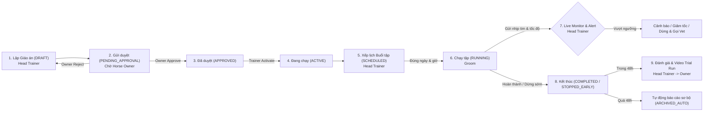

# Tài Liệu Học & Giải Trình Flow Training Horse (Dành Cho Bảo Vệ Hội Đồng)

Tài liệu này tổng hợp toàn bộ luồng **Huấn luyện ngựa (Training Flow)** từ lúc lập giáo án đến khi kết thúc buổi tập và đánh giá, chỉ rõ **code nằm ở đâu**, **dùng làm gì**, **lấy dữ liệu từ đâu** và **gửi dữ liệu đi đâu**.

---

## 1. Bức Tranh Toàn Cảnh (End-to-End Flow)

---

## 2. Bản Đồ Code (Code Map)

| Giai đoạn | Frontend (Giao diện & API) | Backend Controller | Backend Service (Logic chính) | Repository & Bảng DB chính |
| :--- | :--- | :--- | :--- | :--- |
| **1. Giáo án (Training Plan)** | `TrainingPlanPage.js` `trainingPlanApi.js` `ownerTrainingApi.js` | `TrainingPlanController.java` (`/api/training-plans`) | `TrainingPlanService.java` | `TrainingPlanRepository.java` (`TRAINING_PLAN`, `PLAN_PHASE`, `HORSE`, `APP_USER`) |
| **2. Xếp lịch & Chạy buổi tập** | `SchedulePage.js` `groomApi.js` | `TrainingSessionController.java` (`/api/training-sessions`) | `TrainingSessionService.java` | `TrainingSessionRepository.java` (`TRAINING_SESSION`, `PLAN_PHASE`, `TRAINING_LOCK`) |
| **3. Live Monitor & Cảnh báo** | `LiveSessionMonitorPage.js` `liveSessionApi.js` | `AlertController.java` (`/api/sessions/{id}/vitals`, `/api/alerts`) | `AlertService.java` | `AlertRepository.java` (`THRESHOLD_ALERT`, `TRAINING_SESSION`) |
| **4. Dừng khẩn cấp & Khóa tập** | `LiveSessionMonitorPage.js` `VetLockIssuedPage.js` | `IncidentController.java` `TrainingLockController.java` | `IncidentService.java` `SessionStopper.java` `TrainingLockService.java` | `IncidentRepository.java` `TrainingLockRepository.java` (`INCIDENT_REPORT`, `VET_CALL`, `TRAINING_LOCK`) |
| **5. Đánh giá & Video Trial Run** | `SessionEvaluationPage.js` `sessionEvaluationApi.js` | `SessionController.java` `TrialRunController.java` (`/api/sessions`) | `SessionService.java` `TrialRunService.java` | `SessionRepository.java` `TrialRunRepository.java` (`TRAINING_SESSION`) |
| **6. Tự động hóa (Job nền)** | *(Chạy ngầm theo lịch)* | *(Không có Controller)* | `MissedTaskJob.java` | Gọi `TrainingPlanService`, `TrainingSessionService`, `SessionService` |

> **Đường dẫn gốc trên máy:**
> - Backend: `backend/src/main/java/racehorse/backend/` (`controller/`, `service/`, `repository/`, `dto/`)
> - Frontend: `frontend/src/features/trainer/`, `frontend/src/features/groom/`, `frontend/src/features/horse-owner/`

---

## 3. Chi Tiết Luồng Dữ Liệu Từng Chặng

### Chặng 1: Lập, Cập Nhật & Duyệt Giáo Án (`TrainingPlan`)

#### 1.1. Tạo giáo án (`DRAFT`)
* **Code nằm ở đâu:** `TrainingPlanController.create()` $\rightarrow$ `TrainingPlanService.create()` (`@Transactional`).
* **Dùng làm gì:** Head Trainer tạo giáo án cho 1 con ngựa gồm thông tin chung (`planName`, `startDate`, `endDate`, `groomId`) và danh sách các giai đoạn (`phases`).
* **Lấy dữ liệu từ đâu:**
  * Request body `TrainingPlanRequest` từ UI (`TrainingPlanPage.js`).
  * Kiểm tra từ DB qua `HorseRepository` (ngựa phải là `ACADEMY`, chưa `withdrawn`, đúng Trainer quản lý), `StaffRepository` (Groom phải `ACTIVE`, thuộc Trainer đó, và đang phụ trách `< 2` giáo án chưa `COMPLETED`), `TrainingPlanRepository.existsOpenPlan()` (ngựa chưa có plan nào đang mở).
* **Gửi dữ liệu đi đâu:**
  * Ghi vào DB bảng `TRAINING_PLAN` (status mặc định `DRAFT`) và `PLAN_PHASE` (trong cùng 1 transaction: nếu 1 phase lỗi thì rollback cả plan).
  * Ghi log vào `AUDIT_LOG` (`TRAINING_PLAN_CREATE`).
  * Trả về `TrainingPlanResponse` (HTTP 201).

#### 1.2. Gửi duyệt, Chủ ngựa duyệt & Kích hoạt (`PENDING_APPROVAL` $\rightarrow$ `APPROVED` $\rightarrow$ `ACTIVE`)
* **Code nằm ở đâu:**
  * Đổi trạng thái: `TrainingPlanController.changeStatus()` $\rightarrow$ `TrainingPlanService.changeStatus()`.
  * Chủ ngựa duyệt: `TrainingPlanController.ownerReview()` $\rightarrow$ `TrainingPlanService.ownerReview()`.
* **Dùng làm gì:** Kiểm soát luồng trạng thái chặt chẽ (`TRANSITIONS` Map): Head Trainer gửi duyệt $\rightarrow$ chỉ `HORSE_OWNER` sở hữu ngựa mới được duyệt (`APPROVED`) hoặc từ chối (`DRAFT`, bắt buộc ghi lý do) $\rightarrow$ Head Trainer mới được kích hoạt (`ACTIVE`).
* **Lấy dữ liệu từ đâu:**
  * Kiểm tra điều kiện kích hoạt tại `checkCanActivate()`: đọc `HORSE` (status phải là `ELIGIBLE` hoặc `MONITOR`), `TRAINING_LOCK` (chặn nếu khóa `FULL`, cho phép nếu `HEAVY_WORK_ONLY`), `endDate >= today`, và `existsActivePlan`.
* **Gửi dữ liệu đi đâu:**
  * Cập nhật `TRAINING_PLAN.status`.
  * Ghi `AUDIT_LOG`.
  * Bắn `Notification` (`Notice`) cho `HORSE_OWNER` (khi gửi duyệt), cho `HEAD_TRAINER` (khi Owner duyệt/từ chối), và cho `GROOM` phụ trách (khi plan chuyển sang `ACTIVE`).

#### 1.3. Cập nhật giáo án khi đang chạy & Cơ chế chờ duyệt (`Pending Update`)
* **Code nằm ở đâu:**
  * Đề xuất sửa: `TrainingPlanController.update()` $\rightarrow$ `TrainingPlanService.update()`.
  * Owner duyệt bản sửa: `TrainingPlanController.reviewPendingUpdate()` (`PUT /api/training-plans/{id}/update-review`) $\rightarrow$ `TrainingPlanService.reviewPendingUpdate()`.
  * Tự động hủy sau 2 ngày: `TrainingPlanService.expireOverduePendingUpdates()`.
* **Dùng làm gì:**
  * Nếu plan đang `DRAFT`/`PENDING_APPROVAL`: sửa trực tiếp luôn (`applyPlanChanges`).
  * Nếu plan đã `APPROVED`/`ACTIVE`/`PAUSED`: **không ghi đè số liệu cũ ngay**, mà lưu bản đề xuất vào `pendingUpdate`. Trong thời gian chờ, mọi buổi tập vẫn chạy theo **số liệu cũ**.
  * Nếu Owner đồng ý $\rightarrow$ mới áp dụng số liệu mới (`applyPlanChanges`). Nếu Owner từ chối hoặc **quá 2 ngày (48h) không duyệt** $\rightarrow$ hệ thống tự xóa bản pending, giữ nguyên giáo án cũ.
* **Gửi dữ liệu đi đâu:** Lưu/xóa pending trong `TRAINING_PLAN`, ghi `AUDIT_LOG` (`TRAINING_PLAN_UPDATE_PENDING` / `APPROVED` / `REJECTED` / `AUTO_REJECTED`), gửi `Notice` cho Owner hoặc Head Trainer.

---

### Chặng 2: Xếp Lịch & Đổi Lịch Buổi Tập (`TrainingSession`)

* **Code nằm ở đâu:** `TrainingSessionController.create()` / `reschedule()` / `cancel()` $\rightarrow$ `TrainingSessionService.java`.
* **Dùng làm gì:** Head Trainer xếp các buổi tập cụ thể nằm trong từng `PLAN_PHASE` của giáo án đang `ACTIVE`.
* **Lấy dữ liệu từ đâu:**
  * Request `TrainingSessionRequest` (`phaseId`, `assignedTo`, `sessionDate`, `plannedDistance`, `plannedDuration`, `velocityCeiling`).
  * **Lưu ý bảo mật/nghiệp vụ:** `horseId` **không nhận từ client**, mà backend tự tra từ `phaseId` (`findPhaseContext`) để chống giả mạo. Nếu không truyền `velocityCeiling`, tự lấy mặc định theo `targetVelocity` của Phase.
  * Kiểm tra qua `checkHorseCanTrain()` (ngựa không bị `FULL` lock; nếu `HEAVY_WORK_ONLY` lock thì `plannedDistance <= 1200m`; không có `IncidentReport` đang mở) và `checkSlot()`:
    * Giờ tập nằm trong `startDate`–`endDate` của Phase, không ở quá khứ, thời lượng 15–720 phút (chia hết cho 5) và không vắt qua `23:59` ngày hôm sau.
    * **1 ngựa tối đa 1 buổi/ngày** (trừ `CANCELLED`), cách nhau tối thiểu `minGapMinutes` (mặc định 90 phút), không vượt `sessionsPerWeek` (tính từ Thứ Hai).
    * **1 Groom** không được trùng giờ hoặc đang chạy buổi khác, và cách buổi của ngựa khác tối thiểu 90 phút.
* **Gửi dữ liệu đi đâu:**
  * Lưu vào bảng `TRAINING_SESSION` (trạng thái `SCHEDULED`), ghi `AUDIT_LOG` (`TRAINING_SESSION_ASSIGN` / `RESCHEDULE` / `CANCEL`).
  * Gửi `Notice` đến Groom được phân công (`assignedTo`).

---

### Chặng 3: Thực Thi Buổi Tập & Giám Sát Live (`Start / Vitals / Alert / Finish`)

#### 3.1. Bắt đầu buổi tập (`SCHEDULED` $\rightarrow$ `RUNNING`)
* **Code nằm ở đâu:** `TrainingSessionController.start()` (`PUT /api/training-sessions/{id}/start`) $\rightarrow$ `TrainingSessionService.start()`.
* **Dùng làm gì:** Groom (đúng người được giao `assignedTo`) hoặc Head Trainer bấm bắt đầu khi ra sân.
* **Lấy dữ liệu từ đâu:** Kiểm tra trạng thái `SCHEDULED`, phải đúng ngày hôm nay, đã tới giờ `sessionDate` và chưa quá `sessionDate + plannedDuration` (nếu đã quá khung giờ mà mới bấm Start thì hệ thống tự `CANCELLED` buổi đó). Kiểm tra lại sức khỏe ngựa (`checkHorseCanTrain`) và đảm bảo cả ngựa lẫn Groom đều không có buổi nào khác đang `RUNNING`.
* **Gửi dữ liệu đi đâu:** Update `TRAINING_SESSION.status = 'RUNNING'`, ghi `AUDIT_LOG` (`TRAINING_SESSION_START`).

#### 3.2. Gửi chỉ số & Bật cảnh báo vượt ngưỡng (`recordVitals` & `Alert`)
* **Code nằm ở đâu:** `AlertController.recordVitals()` (`POST /api/sessions/{sessionId}/vitals`) $\rightarrow$ `AlertService.recordVitals()`.
* **Dùng làm gì:** Nhận nhịp tim (`heartRate`) và vận tốc (`velocity`) từ Groom/thiết bị khi buổi tập đang `RUNNING`.
* **Lấy dữ liệu từ đâu:**
  * Lấy `heartRateCeiling` từ `PLAN_PHASE`, và `velocityCeiling` từ `TRAINING_SESSION` (nếu null mới fallback về ngưỡng chung `18.0 m/s`).
  * Kiểm tra `AlertRepository.latestOpenSeverity()` trong **60 giây gần nhất** (`DEDUPE_SECONDS = 60`).
* **Gửi dữ liệu đi đâu:**
  * Cập nhật `peak_heart_rate` và `peak_velocity` vào `TRAINING_SESSION`.
  * Nếu vượt ngưỡng: tính mức độ theo % vượt ($\ge 10\%$ là `HIGH`, $\ge 5\%$ là `MEDIUM`, còn lại `LOW`). Trong 60s chỉ tạo bản ghi mới vào `THRESHOLD_ALERT` nếu mức độ tăng lên (chống spam).
  * Nếu mức `HIGH`: bắn `Notice` lên chuông cho **đúng Head Trainer quản lý ngựa đó** (`notifyHorseTrainer`) và cho `VETERINARIAN`.

#### 3.3. Xử lý cảnh báo trên màn Live Monitor (`resolve`)
* **Code nằm ở đâu:** `AlertController.resolve()` (`PUT /api/alerts/{alertId}/resolve`) $\rightarrow$ `AlertService.resolve()`.
* **Dùng làm gì:** Head Trainer xử lý cảnh báo bằng 1 trong các hành động:
  * `CONTINUE`: Ghi nhận tiếp tục.
  * `REDUCE_INTENSITY`: Gửi ngay `Notice` yêu cầu Groom đang dắt ngựa giảm tốc độ.
  * `STOP_SESSION`: Gọi `IncidentService.stopFromAlert()` để dừng ngay buổi tập, tự động tạo `INCIDENT_REPORT` và `VET_CALL` gọi bác sĩ.
  * *(Nếu gọi bác sĩ mà không dừng buổi tập thì đi qua form `POST /api/alerts/{id}/vet-call`).*

#### 3.4. Kết thúc buổi tập (`RUNNING` $\rightarrow$ `COMPLETED` hoặc `STOPPED_EARLY`)
* **Code nằm ở đâu:** `TrainingSessionController.finish()` (`PUT /api/training-sessions/{id}/finish`) $\rightarrow$ `TrainingSessionService.finish()`.
* **Dùng làm gì:** Groom hoặc Head Trainer kết thúc buổi tập.
  * Nếu đã qua giờ kết thúc dự kiến (`plannedEnd`) và không yêu cầu dừng sớm $\rightarrow$ `COMPLETED`.
  * Nếu chưa tới `plannedEnd` hoặc có cờ `earlyStop` $\rightarrow$ `STOPPED_EARLY`: bắt buộc chọn lý do chuẩn (`TARGET_REACHED`, `HORSE_FATIGUED`, `WEATHER_CONDITION`, `EQUIPMENT_ISSUE`, `INJURY`, `NO_HEAD_TRAINER`) và **bắt buộc đã ghi nhận cả Nhịp tim lẫn Tốc độ ít nhất 1 lần** (trừ trường hợp `NO_HEAD_TRAINER`).
* **Gửi dữ liệu đi đâu:** Update `TRAINING_SESSION`, ghi `AUDIT_LOG`, gửi `Notice` cho **đúng Head Trainer phụ trách ngựa** (`notifyHorseTrainer`) nhắc vào đánh giá trong 48h.

---

### Chặng 4: Khóa Tập & Dừng Khẩn Cấp (`TrainingLock` & `SessionStopper`)

* **Code nằm ở đâu:** `TrainingLockService.issue()` $\rightarrow$ `SessionStopper.stopRunningSessions()`.
* **Dùng làm gì:** Khi Bác sĩ thú y / Manager phát lệnh khóa tập (`FULL` hoặc `HEAVY_WORK_ONLY`):
  * Lưu lệnh khóa vào `TRAINING_LOCK`.
  * `SessionStopper` lập tức tìm và dừng mọi buổi đang `RUNNING` của ngựa đó, ghi `AUDIT_LOG` và báo cho Groom dừng dắt ngựa ngay để đảm bảo an toàn.
  * Sau khi ổn định, nếu là khóa `HEAVY_WORK_ONLY`, hệ thống vẫn cho phép tạo/chạy buổi mới với điều kiện quãng đường `<= 1200m`. Nếu là khóa `FULL`, chặn hoàn toàn mọi buổi tập và kích hoạt giáo án mới.

---

### Chặng 5: Đánh Giá Sau Buổi Tập, Video Chạy Thử & Tự Động Hóa

#### 5.1. Đánh giá chính thức & Gắn video chạy thử (`Evaluation` & `TrialRun`)
* **Code nằm ở đâu:**
  * Đánh giá: `SessionController.evaluate()` (`PUT /api/sessions/{id}/evaluation`) $\rightarrow$ `SessionService.evaluate()`.
  * Video Trial Run: `TrialRunController.update()` (`PUT /api/sessions/{id}/trial-run`) $\rightarrow$ `TrialRunService.update()`.
* **Dùng làm gì:**
  * Head Trainer nhập quãng đường thực tế, thời lượng thực tế, nhịp tim TB/Peak/Recovery, tốc độ Peak, xếp loại (`POOR`/`FAIR`/`GOOD`/`EXCELLENT`) và nhận xét (`remarks`).
  * Service kiểm tra logic vật lý: `peakHeartRate >= avgHeartRate`, `recoveryHeartRate <= peakHeartRate`, link video phải là `http://` hoặc `https://` (chống XSS `javascript:`), và buổi `STOPPED_EARLY` không thể bị chấm đè thành `COMPLETED`.
* **Gửi dữ liệu đi đâu:** Update `TRAINING_SESSION`, ghi `AUDIT_LOG` (`EVALUATE_SESSION` / `EVALUATE_ARCHIVED_SESSION`), gửi `Notice` thông báo kết quả chính thức (hoặc video chạy thử mới) đến `HORSE_OWNER`.

#### 5.2. Tự động hóa khi quá hạn (`MissedTaskJob`)
* **Code nằm ở đâu:** `MissedTaskJob.java` (chạy định kỳ bằng `@Scheduled`):
  * `runDaily()` (00:15 mỗi ngày): gọi `TrainingPlanService.completeExpiredPlans()` để đóng các giáo án quá `endDate` và hủy các buổi còn lại.
  * `runPeriodicTrainingChecks()` (mỗi 60 giây):
    1. `TrainingSessionService.processOverdueSessions()`: Tự kết thúc (`COMPLETED`) các buổi `RUNNING` đã quá `plannedDuration`, tự hủy (`CANCELLED`) các buổi `SCHEDULED` đã quá khung giờ.
    2. `SessionService.processOverdueReviews()`: Sau **48 giờ** kết thúc mà Head Trainer chưa chấm $\rightarrow$ tự tổng hợp **báo cáo sơ bộ** từ chỉ số Groom đã gửi (gắn cảnh báo rõ *"NOT an official review from Head Trainer"*), chuyển sang `ARCHIVED_AUTO`, gửi thông báo cho `HORSE_OWNER` và nhắc `HEAD_TRAINER` vào chấm lại chính thức.
    3. `TrainingPlanService.expireOverduePendingUpdates()`: Tự động từ chối các đề xuất sửa giáo án quá **2 ngày** mà Owner chưa duyệt.

---

## 4. Cheat-Sheet Trả Lời Nhanh Câu Hỏi Hội Đồng

1. **Tại sao Head Trainer không tự `ACTIVE` được giáo án?**
   $\rightarrow$ Vì ngựa đua là tài sản của `HORSE_OWNER`, cần Owner xem xét mục tiêu, quãng đường, ngưỡng nhịp tim rồi bấm `APPROVED` thì Trainer mới được `ACTIVE` (`TrainingPlanService`).
2. **Nếu giáo án đang `ACTIVE` mà Head Trainer sửa thông số thì sao?**
   $\rightarrow$ Hệ thống lưu vào `pendingUpdate`, vẫn giữ nguyên số liệu cũ để không ảnh hưởng buổi đang tập. Chỉ khi Owner duyệt mới áp dụng; nếu từ chối hoặc quá 2 ngày không duyệt thì tự hủy (`reviewPendingUpdate` & `expireOverduePendingUpdates`).
3. **Tại sao 1 Groom chỉ được gắn tối đa 2 Plan tính cả `DRAFT`?**
   $\rightarrow$ Để giữ chỗ năng lực (capacity reservation), tránh việc tạo 10 plan `DRAFT` cho cùng 1 Groom rồi khi kích hoạt đồng loạt bị xung đột quá tải (`TrainingPlanRepository.countActivePlansByGroom`).
4. **Hệ thống xử lý thế nào để cảm biến/Groom gửi nhịp tim liên tục không làm ngập thông báo?**
   $\rightarrow$ Có cơ chế Deduplication 60 giây trong `AlertService`: cùng 1 buổi, cùng loại chỉ số, trong 60s chỉ tạo alert mới nếu mức độ nghiêm trọng tăng lên (`LOW` $\rightarrow$ `MEDIUM` $\rightarrow$ `HIGH`). Và chỉ mức `HIGH` (vượt $\ge 10\%$) mới đẩy chuông thông báo cho đúng Head Trainer quản lý ngựa đó và Bác sĩ thú y.
5. **Sự khác nhau giữa `targetVelocity` ở Phase và `velocityCeiling` ở Session là gì?**
   $\rightarrow$ `targetVelocity` ở Phase là tốc độ mục tiêu chuyên môn để đánh giá hiệu quả khi kết thúc giáo án; còn `velocityCeiling` ở từng Session là ngưỡng giới hạn an toàn tối đa của buổi đó để bật cảnh báo sức khỏe (giống `heartRateCeiling`).
6. **Nếu Groom quên bấm Finish hoặc Head Trainer quên chấm điểm thì sao?**
   $\rightarrow$ `MissedTaskJob` quét mỗi 60s: buổi `RUNNING` quá giờ tự chốt `COMPLETED`; quá 48h chưa đánh giá tự sinh báo cáo sơ bộ (`ARCHIVED_AUTO`) gửi Owner và chờ Head Trainer vào đánh giá chính thức lại.
